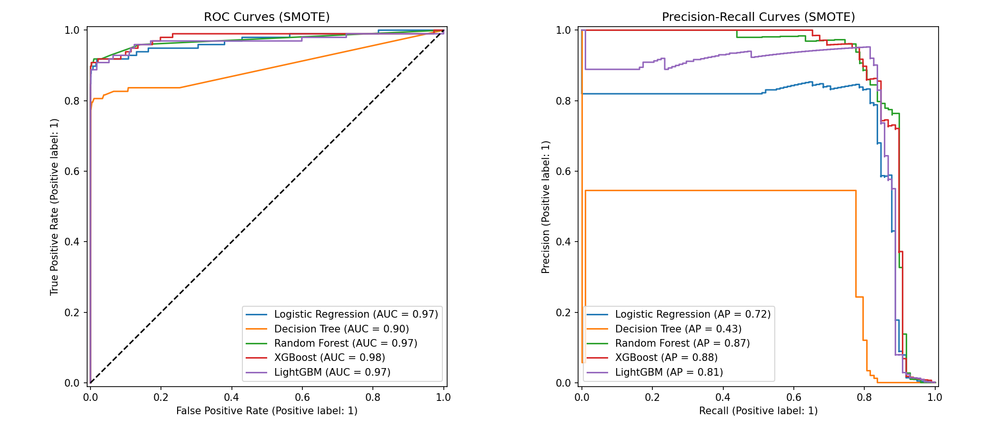

# Financial Fraud Detection (Imbalanced Classification)

Fraud is rare, but it's expensive. This project builds a system that catches most fraudulent card payments without blocking too many legitimate ones.

## The problem

The dataset is the [ULB Credit Card Fraud dataset](https://www.kaggle.com/datasets/mlg-ulb/creditcardfraud) from Kaggle: 284,807 transactions, of which only 492 (0.17%) are fraud. At that imbalance, a model that predicts "never fraud" scores 99.8% accuracy and catches nothing, so accuracy is the wrong metric here.

## What I did

- **Exploratory analysis:** class balance, amount distribution, feature correlations
- **Imbalance handling:** compared SMOTE, ADASYN and class weighting
- **Models:** Logistic Regression, Decision Tree, Random Forest, XGBoost, LightGBM
- **Evaluation:** PR-AUC, ROC-AUC, recall and confusion matrices, with stratified k-fold cross-validation
- **Tuning:** GridSearchCV for XGBoost and LightGBM
- **Calibration:** checked how trustworthy the predicted probabilities are
- **Business cost:** tuned the decision threshold using a cost matrix (missed fraud = $500, false alarm = $10)

## Results

Best model: **XGBoost with SMOTE**

| Metric | Value |
|---|---|
| PR-AUC | 0.877 |
| Fraud recall | 0.888 (about 9 in 10 frauds caught) |
| Expected cost on test set | $5,820 |



## Project structure

| File | Purpose |
|---|---|
| `eda.py` | Exploratory data analysis and charts |
| `models.py` | Model training and comparison |
| `hyperparams.py` | GridSearchCV tuning |
| `calibration.py` | Probability calibration curves |
| `main.py` | Runs the full pipeline |
| `*.png` | Generated charts |

## How to run

1. Download `creditcard.csv` from the [Kaggle dataset](https://www.kaggle.com/datasets/mlg-ulb/creditcardfraud) and place it in the project folder (it is not included because of its size).
2. Install the libraries:
   ```
   pip install pandas numpy scikit-learn imbalanced-learn xgboost lightgbm matplotlib seaborn
   ```
3. Run:
   ```
   python main.py
   ```

## Author

Takudzwa (Sean) Chisvo, BSc Computer Science (AI & Data Science), Vizja University, Warsaw.
